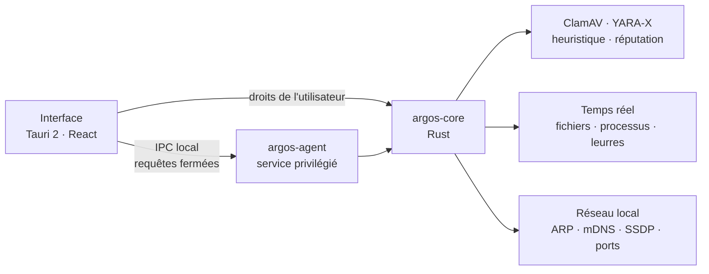

<p align="center">
  
</p>

<p align="center">
  <a href="https://github.com/Yoyotaa/argos-releases/releases/latest"></a>
  
  
  
</p>

<h3 align="center">
  <a href="https://github.com/Yoyotaa/argos-releases/releases/latest">⬇&nbsp;&nbsp;Télécharger Argos</a>
</h3>

<p align="center">
  <b>Argos</b> veille sur ton ordinateur <b>en plus</b> de la protection déjà intégrée (Microsoft Defender, XProtect).<br>
  Il surveille ton réseau, repère ce qui s'installe en douce, piège les rançongiciels et t'explique tout, en français simple.<br>
  Sans compte. Sans publicité. Sans rien collecter.
</p>

---

<table>
<tr>
<td width="50%" valign="top">

### 🌱 Tu débutes ?

Commence par **[Argos en 30 secondes](#-argos-en-30-secondes)**, puis **[Installer](#-installer)**.
Tout est expliqué sans jargon, pas à pas.

[Le guide complet pour débuter →](docs/GUIDE.md)

</td>
<td width="50%" valign="top">

### 🛠️ Tu t'y connais ?

Va droit à **[Sous le capot](#-sous-le-capot)** : moteurs, temps réel, agent privilégié, flux réseau et signature des mises à jour.

[La documentation technique →](docs/TECHNIQUE.md)

</td>
</tr>
</table>

## Sommaire

- **Pour tout le monde** · [Argos en 30 secondes](#-argos-en-30-secondes) · [Ce qu'il fait pour toi](#-ce-quil-fait-pour-toi) · [Installer](#-installer) · [Mettre à jour](#-mettre-à-jour) · [Ta vie privée](#-ta-vie-privée) · [Argos et ton antivirus](#-argos-et-ton-antivirus) · [Questions fréquentes](#-questions-fréquentes)
- **Pour les initiés** · [Sous le capot](#-sous-le-capot) · [Ce qui sort de la machine](#-ce-qui-sort-de-la-machine) · [Mises à jour signées](#-mises-à-jour-signées) · [Vérifier un téléchargement](#-vérifier-un-téléchargement) · [Signaler une faille](#-signaler-une-faille)

---

## ✨ Argos en 30 secondes

Imagine ta maison.

- **Defender** (Windows) ou **XProtect** (macOS), c'est **le vigile à l'entrée** : il contrôle ce qui entre et refoule les menaces connues. Il est déjà là, et il est bon.
- **Argos**, ce sont **les caméras et l'enquêteur** : il regarde ce qui se passe à l'intérieur. Qui est branché sur ton Wi-Fi ? Qu'est-ce qui s'est installé hier soir ? Qui est en train de chiffrer tes photos ? Et surtout, il **te l'explique**.

Argos ne remplace pas ton antivirus. Il **voit ce que les autres ne montrent pas**.

## 🛡️ Ce qu'il fait pour toi

| | |
|---|---|
| 🔍 **Analyse** | Vérifie un fichier, un dossier ou tout le disque avec trois moteurs. Glisse un fichier dans la fenêtre, c'est tout. |
| ⚡ **Temps réel** | Juge chaque fichier qui arrive (Téléchargements, Bureau…) et chaque programme lancé. |
| 🔒 **Anti-rançongiciel** | Des fichiers pièges donnent l'alarme dès qu'un programme commence à chiffrer tes documents, et le coupable est stoppé. |
| 🌐 **Réseau** | Une carte de tous les appareils de ta maison, les ports ouverts, l'état de ta box. Un intrus ou une fausse box est signalé tout de suite. |
| 🩺 **Santé** | Un score de sécurité sur 100 et des corrections en un clic. |
| 📦 **Mises à jour** | Les logiciels pas à jour, ceux exposés à Internet en premier. |
| 🕵️ **Enquête** | Ce qui se relance tout seul au démarrage, ce qui a changé, et une chronologie de la machine. |
| 👁️ **Confidentialité** | Qui a utilisé ta webcam, ton micro, et si un mot de passe a fuité. |
| 🎮 **Mode jeu** | Silencieux pendant tes parties, intraitable face à une attaque. |
| 👨‍👩‍👧 **Famille** | Veille sur le PC de tes proches, directement d'appareil à appareil (Tailscale). |
| 🤖 **Assistant** | Réponds à tes questions en français, avec un modèle qui tourne **sur ta machine** (Ollama, à installer à part). |

## 📥 Installer

> **Avant de commencer :** Argos est gratuit, mais il n'est pas encore « signé » par Microsoft ou Apple (un certificat coûte plusieurs centaines d'euros par an). Ton système affichera donc un avertissement la première fois. C'est normal, voici comment passer.

<details open>
<summary><b>🪟 Windows 10 et 11</b></summary>

1. Ouvre la **[page de la dernière version](https://github.com/Yoyotaa/argos-releases/releases/latest)** et télécharge `Argos_…_Windows_x64-setup.exe`.
2. Double-clique dessus.
3. Si Windows affiche **« Windows a protégé votre ordinateur »** : clique sur **Informations complémentaires**, puis **Exécuter quand même**.
4. Suis l'installation, puis ouvre Argos. Un court tutoriel te présente tout (tu peux le passer).
5. *Facultatif mais conseillé :* dans **Paramètres → Agent Argos**, clique sur **Installer l'agent** pour débloquer les protections avancées (mot de passe administrateur demandé).

</details>

<details open>
<summary><b>🍎 macOS 11 ou plus récent (puces Apple et Intel)</b></summary>

1. Ouvre la **[page de la dernière version](https://github.com/Yoyotaa/argos-releases/releases/latest)** et télécharge `Argos_…_macOS_universel.dmg`.
2. Ouvre le fichier et fais glisser **Argos** dans le dossier **Applications**.
3. Ouvre Argos. Si macOS dit qu'il **ne peut pas vérifier le développeur** : clique sur **OK**, ouvre **Réglages Système → Confidentialité et sécurité**, descends et clique sur **Ouvrir quand même**.
4. Le tutoriel te présente tout (tu peux le passer).
5. *Facultatif mais conseillé :* dans **Paramètres → Agent Argos**, clique sur **Installer l'agent** (mot de passe administrateur demandé).

</details>

> 💡 Les fichiers `.sig`, `.tar.gz` et `latest.json` d'une version servent à la mise à jour automatique : tu n'en as pas besoin.

## 🔄 Mettre à jour

Tu n'as rien à faire. Quand une nouvelle version sort :

1. une pastille **« Argos x.y.z »** brille en haut de la fenêtre ;
2. un clic te montre **ce qui change**, version par version, sans quitter l'application ;
3. **Installer** télécharge, vérifie la signature, installe et relance Argos.

Argos ne vérifie qu'**au plus toutes les 6 heures**, et tu peux couper la vérification automatique dans **Paramètres → Mises à jour d'Argos**. Après une mise à jour, une fenêtre **« Quoi de neuf »** résume les changements.

## 🔐 Ta vie privée

> **Le développeur d'Argos n'a accès à aucune de tes données. Et ça ne changera pas sans ton accord.**

- **Pas de compte**, pas d'adresse e-mail demandée.
- **Pas de télémétrie**, pas de statistiques d'usage, pas de rapport de plantage envoyé.
- **Pas de serveur Argos.** Rien de ce que voit Argos ne m'est envoyé.
- **Pas de publicité**, pas de revente, jamais.
- Si un jour une fonction devait partager quelque chose avec moi (un rapport de plantage, par exemple), elle serait **désactivée par défaut** et te demanderait **d'abord ton accord**, clairement, dans l'application.

Quelques fonctions contactent **des services publics précis**, et uniquement pour ce qu'elles font. Tu choisis lesquelles dès la première ouverture, et la page **Transparence** de l'application liste tout, avec un interrupteur pour chacune. Le détail est [plus bas](#-ce-qui-sort-de-la-machine) et dans [docs/CONFIDENTIALITE.md](docs/CONFIDENTIALITE.md).

## ⚖️ Argos et ton antivirus

**Garde Defender ou XProtect activé.** Argos tourne à côté, sans conflit, et **ne les désactive jamais**.

| | Argos | Antivirus classique |
|---|:---:|:---:|
| Bloque les menaces connues **avant** qu'elles démarrent | ◐ réagit juste après | ✅ |
| Renseignement mondial dans le cloud | ◐ bases publiques, avec ton accord | ✅ |
| Testé par des laboratoires indépendants (AV-TEST…) | ❌ pas encore | ✅ |
| Carte du réseau, ports ouverts, état de la box | ✅ | rarement |
| Ce qui se relance au démarrage, chronologie | ✅ | rarement |
| Anti-rançongiciel par leurres | ✅ | ✅ selon l'offre |
| Tout expliqué simplement | ✅ | ◐ |
| Sans compte, sans collecte de données | ✅ | rarement |
| Gratuit, sans abonnement | ✅ | ◐ |

L'application contient une page **Comparatif** plus complète (face à Microsoft Defender, Bitdefender, Norton 360 et Malwarebytes), qui dit aussi clairement **ce qu'Argos ne fait pas** : pas de VPN, pas de gestionnaire de mots de passe, pas d'extension de navigateur, pas d'analyse des e-mails, pas de téléphones ni de Linux.

## ❓ Questions fréquentes

<details>
<summary><b>Argos est-il gratuit ? Où est le piège ?</b></summary>

Il est gratuit et il n'y a pas de piège : pas de version « premium », pas de publicité, pas de données revendues. C'est un projet personnel.
</details>

<details>
<summary><b>Est-ce que ça ralentit mon ordinateur ?</b></summary>

Très peu au quotidien. Le gros moteur de signatures (ClamAV) ne démarre que pendant une analyse. Le mode jeu met Argos en sourdine pendant tes parties.
</details>

<details>
<summary><b>Dois-je désinstaller mon antivirus ?</b></summary>

Non. Garde Defender (Windows) ou XProtect (macOS). Si tu as un antivirus payant, garde-le aussi : Argos est conçu pour travailler à côté.
</details>

<details>
<summary><b>Pourquoi Windows ou macOS m'avertit à l'installation ?</b></summary>

Parce qu'Argos n'est pas encore signé par un certificat Microsoft ou Apple. Ce n'est pas un signe de danger, mais tu as raison d'être prudent : télécharge Argos **uniquement depuis cette page**, et vérifie l'empreinte si tu veux être sûr ([comment faire](#-vérifier-un-téléchargement)).
</details>

<details>
<summary><b>Pourquoi ce dépôt ne contient-il pas le code source ?</b></summary>

Le code source est privé pour le moment. Ce dépôt sert à publier les versions et à les distribuer aux applications installées. L'installeur Windows est construit par GitHub Actions, l'application macOS sur le Mac du développeur ; les paquets sont ensuite signés hors CI.
</details>

<details>
<summary><b>J'ai trouvé un bug, ou j'ai une idée.</b></summary>

Ouvre une [issue](https://github.com/Yoyotaa/argos-releases/issues). Pour une faille de sécurité, voir [Signaler une faille](#-signaler-une-faille).
</details>

<details>
<summary><b>Comment désinstaller Argos ?</b></summary>

1. Dans **Paramètres → Agent Argos**, clique sur **Désinstaller** (si tu avais installé l'agent).
2. **Windows** : Paramètres → Applications → Argos → Désinstaller. **macOS** : glisse Argos de Applications vers la Corbeille.
3. Pour effacer aussi l'historique, supprime le dossier de données affiché dans la page **Transparence**.
</details>

---

## 🔬 Sous le capot



- **Rust de bout en bout** pour le moteur (`argos-core`), l'interface (Tauri 2) et l'agent.
- **Analyse** : ClamAV via `clamd` (≈ 3,6 millions de signatures, démarré à la demande), YARA-X (règles intégrées + tes propres règles), heuristique sur les exécutables PE et Mach-O (signature absente, packers, injection, capture du clavier, double extension…), puis réputation par empreinte SHA-256.
- **Temps réel** en mode utilisateur : surveillance des dossiers d'arrivée, relevé des processus toutes les 500 ms jugé par des règles de comportement (LOLBins, suppression des sauvegardes, sabotage de Defender, fausses fenêtres de mot de passe…).
- **Anti-rançongiciel** : fichiers canaris + détection de rafales (renommages en extension de rançongiciel, réécritures à forte entropie). Le processus qui écrit le plus est suspendu (macOS) ou arrêté (Windows, si l'arrêt automatique est activé).
- **Quarantaine** chiffrée en AES-256-GCM, restaurable.
- **Agent** (LaunchDaemon / service Windows) : seule une liste fermée de requêtes est acceptée sur un canal local ; il refuse de toucher aux programmes du système et à Argos lui-même.
- **Réseau** : seules les plages privées sont sondées, jamais Internet. Pare-feu piloté via `New-NetFirewallRule` (Windows) ou `socketfilterfw` (macOS).

**Limites assumées** : pas de pilote noyau, donc pas de blocage avant exécution ; un processus qui vit moins d'une demi-seconde peut passer inaperçu. Détail complet dans [docs/TECHNIQUE.md](docs/TECHNIQUE.md).

## 📡 Ce qui sort de la machine

| Fonction | Vers | Ce qui part | Quand | Réglable |
|---|---|---|---|---|
| Nouvelles versions d'Argos | `github.com` | une requête HTTP, rien d'autre | ≤ 1 fois / 6 h | ✅ |
| Réputation des fichiers suspects | `hashlookup.circl.lu`, MalwareBazaar (avec ta clé) | empreinte SHA-256, jamais le fichier | pendant une analyse | ✅ |
| Logiciels pas à jour | winget, Homebrew, Apple, éditeurs | leurs requêtes habituelles | 1 fois / session | ✅ |
| VirusTotal | `virustotal.com` (ta clé) | empreinte SHA-256 | sur clic | à la demande |
| Mots de passe fuités | `api.pwnedpasswords.com` | 5 premiers caractères d'une empreinte SHA-1 (k-anonymat) | sur clic | à la demande |
| Signatures ClamAV | `database.clamav.net` | téléchargement | sur clic | à la demande |
| DNS protecteur | Quad9, Cloudflare ou AdGuard | tes requêtes DNS | si tu le choisis | ✅ |
| Mode Famille | tes proches, via Tailscale | résumé de sécurité | si tu partages | ✅ |
| Carte du réseau, assistant | **ton réseau local / ta machine** | rien ne sort | — | — |

## ✍️ Mises à jour signées

Chaque paquet de mise à jour est signé (minisign, Ed25519). La clé publique est **intégrée à l'application** : Argos refuse d'installer un fichier dont la signature ne correspond pas, même s'il vient de GitHub. La clé privée ne quitte jamais la machine du développeur, et la signature se fait hors de la CI.

Pour ménager GitHub, Argos lit `latest.json` sur `github.com/…/releases/latest/download/` (et non l'API REST, limitée à 60 requêtes par heure), au plus une fois toutes les 6 heures, et une fois par minute au maximum quand tu cliques sur « Vérifier ». Un échec compte comme une vérification : jamais de rafale.

## 🔎 Vérifier un téléchargement

Chaque version publie un fichier `SHA256SUMS.txt`. Compare-le avec l'empreinte de ton fichier :

```powershell
# Windows (PowerShell)
Get-FileHash .\Argos_0.1.0_Windows_x64-setup.exe -Algorithm SHA256
```

```bash
# macOS
shasum -a 256 Argos_0.1.0_macOS_universel.dmg
```

## 🚨 Signaler une faille

Merci de **ne pas** ouvrir d'issue publique. Utilise le [signalement privé de GitHub](https://github.com/Yoyotaa/argos-releases/security/advisories/new). Détails dans [SECURITY.md](SECURITY.md).

---

<p align="center">
  <sub>Fait avec soin par Yoann · <a href="CHANGELOG.md">Journal des modifications</a> · <a href="docs/GUIDE.md">Guide</a> · <a href="docs/TECHNIQUE.md">Technique</a> · <a href="docs/CONFIDENTIALITE.md">Confidentialité</a></sub>
</p>
