# 🔐 Confidentialité

> **Le développeur d'Argos n'a accès à aucune de tes données. Et ça ne changera pas sans ton accord.**

## L'engagement

1. **Rien n'est envoyé au développeur.** Argos n'a ni serveur, ni compte, ni télémétrie, ni statistiques d'usage, ni rapport de plantage automatique.
2. **Pas de publicité, pas de revente.** Jamais.
3. **Consentement d'abord.** Si un jour une fonction devait partager quelque chose avec le développeur (un rapport de plantage, par exemple), elle serait **désactivée par défaut**, présentée clairement dans l'application, et ne s'activerait qu'avec ton accord explicite.
4. **Tout est visible.** La page **Transparence** de l'application liste chaque flux sortant, avec son interrupteur.
5. **Tes fichiers restent chez toi.** Même un fichier suspect n'est jamais envoyé : seule son empreinte peut l'être, si tu l'acceptes.

## Ce qui peut sortir de ta machine

Seulement vers des **services publics précis**, et seulement pour ce que fait la fonction.

### Automatique, avec ton accord (choisi au premier lancement)

| Fonction | Destinataire | Données | Fréquence |
|---|---|---|---|
| Nouvelles versions d'Argos | GitHub (`github.com`) | Une requête HTTP pour `latest.json`. GitHub voit ton adresse IP, comme pour toute page web. | ≤ 1 fois / 6 h |
| Réputation des fichiers suspects | CIRCL hashlookup (CERT du Luxembourg) ; MalwareBazaar (abuse.ch) si tu ajoutes ta clé | L'empreinte SHA-256 d'un fichier jugé suspect. Ni le fichier, ni son nom, ni son chemin. | Pendant une analyse |
| Logiciels pas à jour | winget (Microsoft), Homebrew, Apple, éditeurs des applications (flux Sparkle) | Les mêmes requêtes que leurs propres outils de mise à jour. | 1 fois par session |

### Uniquement quand tu le demandes

| Fonction | Destinataire | Données |
|---|---|---|
| VirusTotal | `virustotal.com`, avec ta clé | L'empreinte SHA-256 du fichier choisi. |
| Mot de passe fuité ? | Have I Been Pwned (`api.pwnedpasswords.com`) | Les **5 premiers caractères** de l'empreinte SHA-1 du mot de passe (k-anonymat). Le mot de passe ne quitte jamais ta machine, et le service ne peut pas le reconstituer. |
| Signatures ClamAV | `database.clamav.net` | Téléchargement des bases. |

### Si tu l'actives

| Fonction | Destinataire | Données |
|---|---|---|
| DNS protecteur | Quad9, Cloudflare ou AdGuard | Tes requêtes DNS (les noms des sites visités) passent par ce fournisseur au lieu de ta box ou de ton opérateur. |
| Mode Famille | Tes proches, directement, via Tailscale (chiffré) | Un résumé : score de sécurité, alertes en attente, protection active. Seulement à qui possède ton code de partage, en lecture seule. |

### Rien ne sort

- **Carte du réseau** : seules les adresses privées de ton réseau local sont sondées.
- **Assistant** : le modèle tourne sur ta machine (Ollama, `127.0.0.1`).
- **Analyse, temps réel, anti-rançongiciel, chronologie, persistance** : entièrement locaux.

## Où sont tes données

Tout est stocké **localement**, dans un seul dossier (affiché dans la page Transparence) :

- macOS : `~/Library/Application Support/fr.yoann.Argos`
- Windows : `%APPDATA%\yoann\Argos\data`

Historique (SQLite), réglages, quarantaine chiffrée (AES-256-GCM), règles personnelles. **Supprimer ce dossier efface tout.**

## Tes clés

Les clés MalwareBazaar et VirusTotal que tu saisis restent dans tes réglages locaux et ne sont envoyées qu'au service concerné.

---

<a href="../README.md">← Retour à l'accueil</a>

