# 🌱 Le guide pour bien démarrer

Ce guide est écrit pour **tout le monde**, même si tu n'as jamais touché à un antivirus. Compte dix minutes.

**Sommaire** · [Ce qu'est Argos](#1-ce-quest-argos-en-vrai) · [Installer](#2-installer) · [Le premier lancement](#3-le-premier-lancement) · [Les gestes du quotidien](#4-les-gestes-du-quotidien) · [Si Argos t'alerte](#5-si-argos-talerte) · [Les mises à jour](#6-les-mises-à-jour) · [Petit lexique](#7-petit-lexique)

---

## 1. Ce qu'est Argos, en vrai

Ton ordinateur a déjà une protection : **Microsoft Defender** sous Windows, **XProtect** sous macOS. Elles sont bonnes pour arrêter les virus connus **à l'entrée**.

Argos ajoute ce qui leur manque souvent :

- 👀 **voir** ce qui se passe : qui est connecté à ton Wi-Fi, ce qui s'est installé, ce qui tourne ;
- 🧠 **comprendre** : chaque alerte dit ce qui se passe, pourquoi c'est risqué et quoi faire ;
- 🪤 **piéger** les rançongiciels (ces programmes qui chiffrent tes photos et réclament de l'argent).

> ✅ **Garde Defender ou XProtect activé.** Argos travaille avec eux, pas à leur place.

## 2. Installer

### 🪟 Sur Windows

1. Va sur la **[page de la dernière version](https://github.com/Yoyotaa/argos-releases/releases/latest)**.
2. Dans **Assets**, clique sur le fichier qui finit par **`_Windows_x64-setup.exe`**.
3. Ouvre-le. Windows peut afficher un écran bleu **« Windows a protégé votre ordinateur »** :
   - clique sur **Informations complémentaires** ;
   - puis sur **Exécuter quand même**.

   *Pourquoi ?* Argos n'a pas encore de certificat Microsoft (payant). Ce message apparaît pour tout programme dans ce cas.
4. Suis l'installation, c'est fini.

### 🍎 Sur Mac

1. Va sur la **[page de la dernière version](https://github.com/Yoyotaa/argos-releases/releases/latest)**.
2. Dans **Assets**, clique sur le fichier qui finit par **`_macOS_universel.dmg`**.
3. Ouvre-le, puis **fais glisser l'icône Argos** sur le dossier **Applications**.
4. Ouvre Argos depuis Applications. Si macOS indique qu'il **ne peut pas vérifier le développeur** :
   - clique sur **OK** ;
   - ouvre **Réglages Système** → **Confidentialité et sécurité** ;
   - descends jusqu'au message sur Argos et clique sur **Ouvrir quand même** ;
   - confirme avec ton mot de passe.

   *Pourquoi ?* Argos n'est pas encore « notarié » par Apple (programme payant). Tu n'auras à le faire qu'une fois.

> 🔐 **Télécharge Argos uniquement depuis cette page GitHub.** Ailleurs, quelqu'un pourrait te proposer une copie piégée.

## 3. Le premier lancement

Argos te propose un **tutoriel d'une minute**. Tu peux le passer avec **Échap**, et le revoir quand tu veux dans **Paramètres**.

Pendant le tutoriel, Argos te demande **trois choix de confidentialité**. Tout est expliqué, et tu peux les changer plus tard dans la page **Transparence** :

| Choix | Ce que ça fait | Notre conseil |
|---|---|---|
| Vérifier les fichiers suspects en ligne | Compare l'**empreinte** d'un fichier suspect (une suite de chiffres, pas le fichier) à des bases publiques de virus connus. | Activé |
| Repérer les logiciels pas à jour | Demande aux magasins de logiciels si tes applications ont des mises à jour. | Activé |
| Chercher les nouvelles versions d'Argos | Regarde sur GitHub, au plus toutes les 6 heures. | Activé |

### L'agent (recommandé)

Certaines protections ont besoin des droits d'administrateur (par exemple lire tout ce qui démarre avec l'ordinateur). Pour les activer : **Paramètres → Agent Argos → Installer l'agent**, puis ton mot de passe. Argos ne le demande qu'une fois.

## 4. Les gestes du quotidien

- 🏠 **Tableau de bord** : un coup d'œil suffit. Le score sur 100 résume ta sécurité ; **« Argos a remarqué »** liste ce qui mérite ton attention. Clique sur une ligne, Argos t'emmène au bon endroit.
- 🔍 **Analyser un fichier douteux** : glisse-le n'importe où dans la fenêtre d'Argos.
- 🌐 **Réseau** : de temps en temps, lance un balayage pour voir qui est connecté chez toi.
- ⌨️ **Raccourci magique** : `Ctrl K` (Windows) ou `⌘ K` (Mac) ouvre la recherche : tape « analyse », « réseau », « jeu »… et Entrée.

## 5. Si Argos t'alerte

Pas de panique. Chaque alerte indique :

1. **ce qui se passe**, en une phrase ;
2. **pourquoi c'est risqué** ;
3. **ce que tu peux faire**, avec un bouton.

| Couleur | Signification |
|---|---|
| 🔴 Rouge | Menace probable : suis la recommandation (souvent « Mettre en quarantaine »). |
| 🟠 Orange | À vérifier : regarde si tu reconnais le programme ou l'appareil. |
| 🔵 Bleu | Pour information. |

La **quarantaine** n'efface rien : le fichier est mis à l'écart, chiffré, et tu peux le **restaurer** si c'était une erreur.

## 6. Les mises à jour

Quand une nouvelle version d'Argos sort, une **pastille brillante** apparaît en haut de la fenêtre. Clique dessus pour voir **ce qui change**, puis sur **Installer** : Argos se met à jour et redémarre tout seul. Rien d'autre à faire.

## 7. Petit lexique

| Mot | En clair |
|---|---|
| **Malware** | Programme malveillant (virus, cheval de Troie, voleur de mots de passe…). |
| **Rançongiciel** | Malware qui chiffre tes fichiers et réclame une rançon. |
| **Quarantaine** | Une « cellule » où un fichier dangereux est enfermé sans être supprimé. |
| **Empreinte (SHA-256)** | Un code unique calculé à partir d'un fichier. On peut reconnaître un fichier connu par son empreinte, sans jamais l'envoyer. |
| **Port ouvert** | Une « porte » d'un appareil qui accepte des connexions. Certaines doivent rester fermées. |
| **DNS** | L'annuaire d'Internet qui transforme un nom de site en adresse. Un DNS protecteur refuse les adresses dangereuses. |
| **Tailscale** | Un réseau privé chiffré entre tes appareils, utilisé par le mode Famille. |

---

<a href="../README.md">← Retour à l'accueil</a> · <a href="TECHNIQUE.md">Documentation technique →</a>

