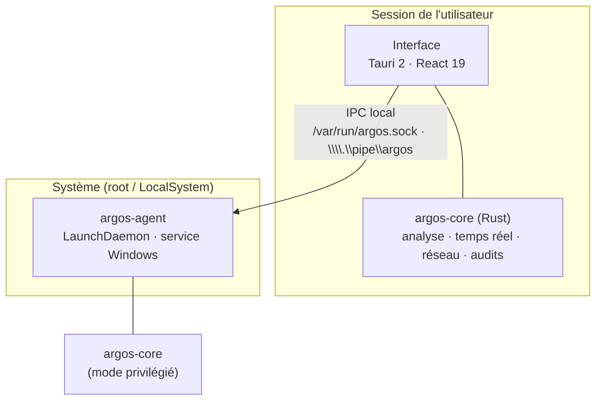

# 🛠️ Documentation technique

Pour celles et ceux qui veulent savoir **exactement** ce que fait Argos, comment, et où sont ses limites.

**Sommaire** · [Architecture](#architecture) · [Analyse](#analyse) · [Temps réel](#temps-réel) · [Anti-rançongiciel](#anti-rançongiciel) · [Réseau](#réseau) · [Agent privilégié](#agent-privilégié) · [Données locales](#données-locales) · [Mises à jour](#mises-à-jour) · [Limites](#limites-connues)

---

## Architecture

| Composant | Rôle | Droits |
|---|---|---|
| `argos-app` | Interface (Tauri 2, WebView du système) et moteur en mode utilisateur | utilisateur |
| `argos-core` | Bibliothèque Rust : analyse, temps réel, réseau, audits, quarantaine | selon l'appelant |
| `argos-agent` | Service système facultatif pour les audits et actions qui exigent l'administrateur | root / LocalSystem |

Pas de serveur, pas de compte, pas de télémétrie : tout s'exécute localement.

## Analyse

Un fichier passe par plusieurs moteurs ; leurs verdicts sont fusionnés.

1. **ClamAV** (facultatif, installé à part) via `clamd`, démarré seulement le temps d'une analyse (≈ 3,6 millions de signatures, environ 1 Go de RAM). Bases mises à jour par `freshclam` à la demande.
2. **YARA-X** : règles intégrées (EICAR, voleurs d'informations génériques, voleurs de jetons Discord, injections Discord, « download cradles » PowerShell, voleurs macOS via `osascript`, outils d'accès à distance) **+ tes propres règles** (`.yar` / `.yara`) dans le dossier `rules/` des données.
3. **Heuristique** sur les exécutables PE et Mach-O : signature absente, sections compressées ou chiffrées (entropie), imports d'injection ou de capture clavier, absence d'imports, double extension trompeuse, emplacement temporaire. Un indice seul ne suffit jamais : un score cumulé déclenche le statut « suspect ».
4. **Réputation** (si activée) : empreinte SHA-256 envoyée à CIRCL hashlookup et, avec ta clé, à MalwareBazaar. VirusTotal uniquement sur demande, avec ta propre clé.

Taille maximale par fichier réglable (64 Mo par défaut pour YARA et l'heuristique ; ClamAV jusqu'à 200 Mo). Exclusions par chemin.

## Temps réel

- **Fichiers** : `notify` (FSEvents / ReadDirectoryChangesW) sur Téléchargements, Bureau, dossiers de démarrage, dossier temporaire (Windows) et le cœur de Discord. Un fichier n'est analysé qu'une fois son écriture terminée (taille stable, pas de `.crdownload` / `.part`).
- **Processus** : la liste est relue **toutes les 500 ms** ; chaque nouveau processus est jugé par des règles de comportement :
  - suppression des sauvegardes (`vssadmin delete shadows`, `wbadmin delete`…) ;
  - sabotage de Defender ;
  - binaires détournés (LOLBins : `mshta`, `rundll32`, `regsvr32`, `certutil`…) avec URL ou script ;
  - interpréteurs (PowerShell, cmd, wscript…) lancés par Word, Excel ou Outlook ;
  - persistance posée en douce (`schtasks`, clé `Run`, `launchctl` depuis `/tmp`), levée de la quarantaine macOS (`xattr`) ;
  - fausses fenêtres de mot de passe (`osascript … hidden answer`).
- **Actions automatiques** (désactivables) : quarantaine d'un fichier malveillant, arrêt d'un processus au comportement critique.

## Anti-rançongiciel

- **Canaris** : des fichiers leurres cachés dans Documents, Bureau et Images. Personne n'a de raison d'y toucher : s'ils changent, un chiffrement est en cours.
- **Rafales** : dans ces dossiers, une série de renommages vers une extension de rançongiciel ou de réécritures à contenu aléatoire en quelques secondes déclenche aussi l'alarme.
- **Réaction** : le processus qui écrit le plus sur le disque est **suspendu** sous macOS (réversible) et **arrêté** sous Windows si l'arrêt automatique est permis.

## Réseau

- **Découverte** : balayage TCP léger de la plage privée locale, table ARP (MAC → fabricant via la base OUI), mDNS, SSDP et descriptions UPnP.
- **Ports** : balayage des ports courants des appareils de **ton** réseau, avec lecture des bannières HTTP(S) pour identifier les services.
- **Box** : redirections UPnP ouvertes vers Internet, DNS utilisés, changement d'adresse MAC de la passerelle (usurpation ARP).
- **Garde-fou** : seules les plages privées (RFC 1918, liens locaux) sont sondées. Jamais Internet, jamais un autre réseau.
- **Blocage d'un programme** : règles `New-NetFirewallRule` entrantes et sortantes (groupe « Argos ») sous Windows ; `socketfilterfw --blockapp` sous macOS (entrant uniquement). Les binaires du système et Argos lui-même sont refusés.
- **DNS protecteur** : Quad9, Cloudflare (1.1.1.2 / famille 1.1.1.3) ou AdGuard, appliqué aux interfaces actives hors VPN.

## Agent privilégié

- Installé à la demande (`Paramètres → Agent Argos`), avec élévation explicite.
- macOS : LaunchDaemon `/Library/LaunchDaemons/…`, binaire copié dans `/Library/Application Support/Argos`, socket `/var/run/argos.sock`.
- Windows : service `ArgosAgent` (démarrage automatique), binaire dans `Program Files\Argos`, canal nommé `\\.\pipe\argos`.
- **Liste fermée de requêtes** sérialisées (audit de persistance, bilan de santé, actions de démarrage, pare-feu, DNS). Aucune exécution de commande arbitraire.
- Après une mise à jour d'Argos, l'application détecte un agent plus ancien et propose de le mettre à jour.

## Données locales

| Élément | Emplacement |
|---|---|
| Dossier de données | macOS : `~/Library/Application Support/fr.yoann.Argos` · Windows : `%APPDATA%\yoann\Argos\data` |
| Base d'historique | SQLite, dans le dossier de données |
| Quarantaine | `quarantine/`, fichiers chiffrés en **AES-256-GCM** |
| Règles personnelles | `rules/` |
| Réglages | `config.json` |
| Cache des mises à jour | `update.json` |

Supprimer ce dossier efface tout ce qu'Argos sait.

## Mises à jour

- **Point de terminaison** : `https://github.com/Yoyotaa/argos-releases/releases/latest/download/latest.json` (pas l'API REST, donc pas de limite à 60 requêtes par heure).
- **Fréquence** : au plus toutes les 6 heures en automatique (désactivable), une fois par minute au maximum à la main ; un échec compte comme une vérification.
- **Signature** : minisign (Ed25519). La clé publique est compilée dans l'application ; un paquet non signé ou modifié est refusé.
- **Paquets** : Windows, l'installeur NSIS lui-même (mode passif) ; macOS, `Argos.app` compressé, remplacé en place puis relancé.
- **Notes** : `latest.json` contient le journal des 15 dernières versions ; l'application affiche celles qui sont plus récentes que la sienne, même si tu as sauté des versions.
- **Chaîne de publication** : les installeurs sont construits par GitHub Actions (Windows x64, macOS universel), puis **signés hors CI** sur la machine du développeur avant publication ici.

## Limites connues

- **Pas de pilote noyau** : Argos réagit juste après le lancement d'un programme au lieu de le bloquer avant. Un processus qui vit moins de 500 ms peut lui échapper.
- **Pas de renseignement mondial** : pas de télémétrie, donc pas de détection collective des menaces inconnues comme chez les grands éditeurs.
- **Pas d'évaluation indépendante** (AV-TEST, AV-Comparatives) à ce jour.
- **Applications non signées** par Microsoft ou Apple : avertissement à l'installation.
- **Plates-formes** : Windows 10/11 x64 et macOS 11+. Pas de Linux, pas de mobile.

---

<a href="../README.md">← Retour à l'accueil</a> · <a href="CONFIDENTIALITE.md">Confidentialité →</a>

